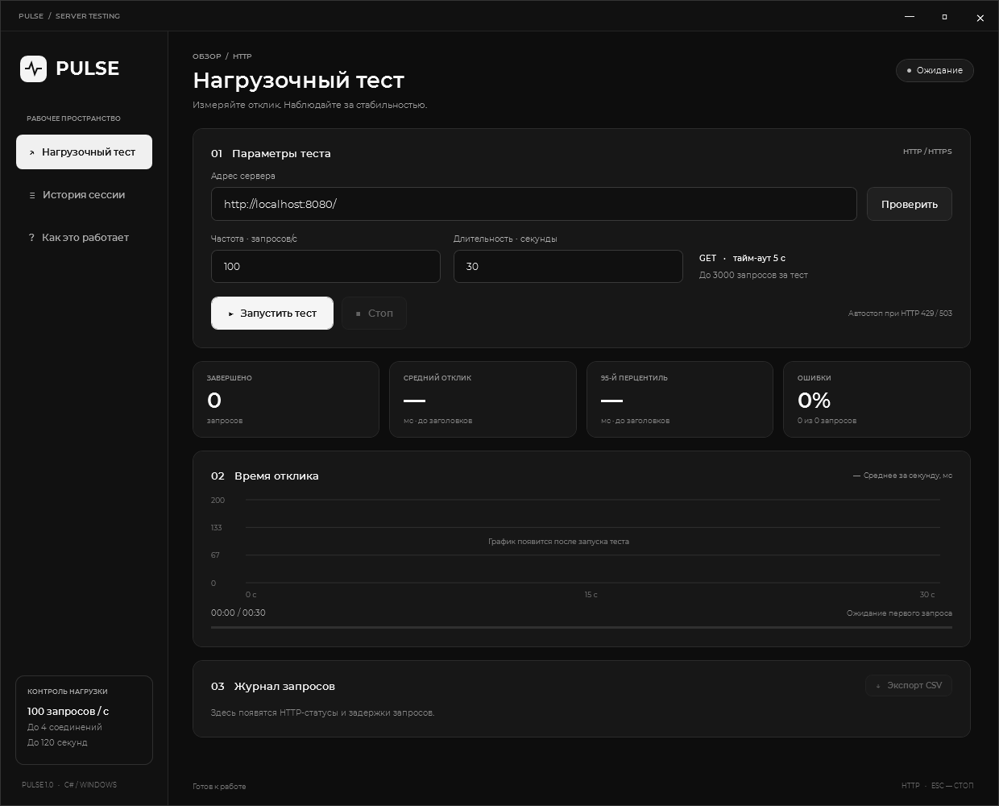

# Pulse Workspace

Приложение на C# / WPF для контролируемого нагрузочного тестирования своего HTTP(S)-сервера. Чёрно-белый интерфейс, шрифт Montserrat с кириллицей, график отклика, P95 и экспорт CSV.



## Скачать и запустить

**[Скачать готовое приложение и исходники — Pulse-Windows.zip](https://github.com/reallynigeuteg7-ux/Pulse-Workspace/raw/refs/heads/main/outputs/Pulse-Windows.zip)**

1. Распакуйте весь архив.
2. Запустите `Pulse/Pulse.exe`. Сохраните папку `assets` и `Pulse.exe.config` рядом с EXE.
3. Введите адрес своего HTTP(S)-сервера.
4. Нажмите **Проверить** или задайте частоту и длительность и нажмите **Запустить тест**.
5. **Стоп** или **Esc** отменяет тест. После завершения доступен **Экспорт CSV**.

Требования: Windows и .NET Framework 4.8 или 4.8.1. Для готовой сборки не нужны .NET SDK, NuGet или установка шрифта.

Если репозиторий уже скачан, приложение находится в `outputs/Pulse/Pulse.exe`.

## Возможности

- Частота **1–100 запросов/с**, по умолчанию **100**.
- Длительность **5–120 секунд**, максимум **4 одновременных запроса**.
- Проверка доступности, HTTP-статуса и заголовков ответа.
- Средний отклик и P95 до получения заголовков, процент ошибок, график и журнал.
- Автостоп при HTTP 429/503 или пяти последовательных ошибках соединения.
- История последних 20 тестов текущей сессии и полный CSV-отчёт.

Заданная частота — верхняя граница. При медленных ответах или занятых соединениях фактическая частота ниже; пропущенные запросы не накапливаются в очередь.

## Исходники и сборка

Проект: **[outputs/Pulse/Pulse.csproj](outputs/Pulse/Pulse.csproj)**.

Откройте его в Visual Studio с компонентами разработки классических .NET-приложений и targeting pack .NET Framework 4.8. Сторонних NuGet-зависимостей нет.

Или выполните из корня репозитория:

```powershell
.\outputs\Pulse\build.ps1
```

Основные файлы:

- [LoadEngine.cs](outputs/Pulse/src/LoadEngine.cs) — запросы, ограничения, статистика и CSV.
- [Dashboard.xaml](outputs/Pulse/src/Dashboard.xaml) — интерфейс и стили.
- [Dashboard.cs](outputs/Pulse/src/Dashboard.cs) — управление интерфейсом и график.
- [Program.cs](outputs/Pulse/src/Program.cs) — запуск приложения.

## Проверки

```powershell
.\outputs\Pulse\build.ps1 -Test
.\outputs\Pulse\test-ui.ps1
```

Тесты используют временный сервер только на `127.0.0.1`. В последнем прогоне прошли **14 проверок движка** и **7 проверок интерфейса**:

- [Результаты проверки движка](outputs/Pulse/tests/engine-results.txt).
- [Результаты проверки интерфейса](outputs/Pulse/tests/ui-results.txt).

## Подробная инструкция

[Запуск, метрики, CSV, ограничения и устройство проекта](outputs/Pulse/README.md).

Montserrat поставляется с [SIL Open Font License](outputs/Pulse/assets/fonts/OFL.txt).
